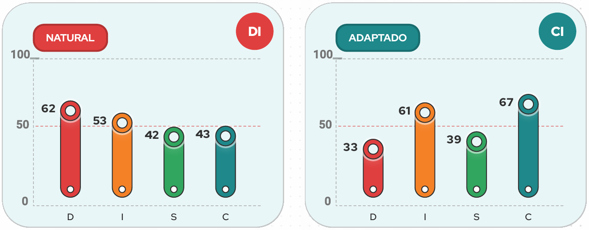
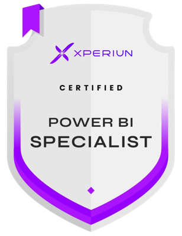

# Olá, eu sou a Ana Júlia 👋

**Analista de Dados & BI** · Automação de processos · Goiânia, GO

## 👩‍💻 Sobre mim

Sou uma profissional de análise de dados que enxerga a tecnologia como meio, não como fim. Meu foco está nas **pessoas e no negócio**, e é a partir dessa visão que uso dados, automações e ferramentas analíticas para resolver problemas reais.

Atuo como **ponte entre TI e as áreas de negócio**, traduzindo necessidades, alinhando expectativas e transformando questões complexas em soluções práticas, simples e estratégicas.

Minhas competências incluem **análise de dados, automação de processos, desenvolvimento de dashboards, gestão de CRM** e, recentemente, **Inteligência Artificial**, área em que desenvolvo agentes de atendimento.

Curso Bacharelado em Administração na **UFG** e tenho quase **5 anos de experiência em Business Intelligence**, com passagem por duas multinacionais, onde aprimorei minha capacidade de interpretar e analisar dados com técnicas estatísticas e ferramentas como **SQL, Power BI e Python**. Sou especialista em Power BI, certificada pela **Xperiun**.

No dia a dia, sou aquela profissional que as pessoas procuram quando precisam de clareza, direcionamento ou de uma solução que conecte processos, tecnologia e pessoas. Busco um trabalho focado em resultados, que contribua de forma significativa para o crescimento da empresa, gere lucro e ajude a conquistar suas metas.

**Aqui você conhecerá um pouco do meu trabalho!** 👇

🌐 Portfólio completo: [Intelidados](https://sites.google.com/view/intelidados-online/p%C3%A1gina-do-projeto) · 💼 [LinkedIn](https://www.linkedin.com/in/ana-julia-portela/)

---

## 🧭 Como eu trabalho

**Perfil comportamental DISC: DI, executora e comunicadora** · Estilo de liderança: Executivo + Motivador · Tipo ENT

*Mapeamento de perfil comportamental · Grupo PRO, 2026*

- 🎯 **Foco em resultado:** encaro problemas como desafios, decido rápido e sigo até a entrega.
- 🤝 **Ponte entre pessoas e tecnologia:** comunicativa e persuasiva, traduzo a necessidade do negócio em solução e engajo as pessoas na mudança.
- 💡 **Crio do zero:** tenho visão do todo e enxergo possibilidades. Rotina repetitiva é exatamente o que eu gosto de automatizar.
- ⚡ **Ritmo acelerado:** rendo mais em ambientes dinâmicos, com projetos novos e várias frentes ao mesmo tempo.
- 🧠 **Racional e prática:** decido com base em lógica e dados.
- 🔄 **Adapto o estilo ao contexto:** no trabalho com dados, ativo um modo mais analítico e cuidadoso, com mais precisão e organização.

**Onde eu rendo mais:** metas claras e mensuráveis, autonomia, desafios novos, contato direto com as áreas de negócio e espaço para propor ideias.

**Como trabalhar comigo:** seja direto. Me dê o objetivo e o prazo, e deixe o "como" comigo. Feedback franco é sempre bem-vindo, e reconhecimento pelas entregas me motiva.

**O que desenvolvo continuamente:** planejamento e atenção aos detalhes. Por isso documento meus processos (Notion, fluxos no FigJam) e transformo rotinas em automações, para ter consistência sem perder velocidade.

---

## 🛠️ Stack

**📊 BI & Análise de Dados**

**🗄️ Bancos de Dados**

**🐍 Programação & Automação**

-3776AB?style=flat&logo=python&logoColor=white)

**🤖 Inteligência Artificial**

-00FFFF?style=flat&logoColor=black)

**☁️ Cloud & Deploy**

-4285F4?style=flat&logo=googlecloud&logoColor=white)

**🔌 Integrações & APIs**

**🧩 CRM, ERP & Gestão**

-1F6FEB?style=flat&logoColor=white)
-6F42C1?style=flat&logoColor=white)
-0B6E4F?style=flat&logoColor=white)

## 🏅 Certificações

**Power BI Specialist** · Xperiun 
**Power BI Avançado** 
**Lean Six Sigma White Belt**

 

---

## 📊 Dashboards (Power BI)

| Projeto | Descrição |
|---|---|
| [Performance de Vendas](https://github.com/anajuliapf/dashboard-performance-vendas) | Faturamento, margem, notas e ticket médio vs. ano anterior, com metas por vendedor |
| [Faturamento x Margem x Custos](https://github.com/anajuliapf/dashboard-faturamento-margem-custos) | Análise comercial por supervisor, vendedor e linha de produto (Power Query + DAX) |
| [Performance do Backoffice](https://github.com/anajuliapf/dashboard-performance-backoffice) | Atividades concluídas vs. pendentes e tempo médio por responsável e cliente |
| [FASPEC – Gestão de CRM](https://github.com/anajuliapf/faspec-gestao-crm) | Funil de captação, atendimento e engajamento de leads de cursos EAD |
| [FASPEC – Faturamento](https://github.com/anajuliapf/faspec-dashboard-faturamento) | Receita, matrículas, ticket médio, canais e distribuição geográfica |

## 🤖 Automações (Python & integrações)

| Projeto | Descrição | Impacto |
|---|---|---|
| [Robô Cíntia](https://github.com/anajuliapf/robo-cintia-inadimplencia) | Alertas em tempo real no Slack sobre operações financeiras | **~6h/semana e ~R$ 40 mil/mês** economizados |
| [Cilia – Análise de Crédito](https://github.com/anajuliapf/cilia-analise-credito) | Pipeline Metabase → Python para elegibilidade de clientes | Processo padronizado e auditável |
| [Cilia – Ofertas Multicanal](https://github.com/anajuliapf/cilia-ofertas-multicanal) | Geração de ofertas e arquivos para WhatsApp, PipeRun, e-mail e telegrama | Telegramas: **9h → 1h30** |
| [RPA – Lançamento de Visitas](https://github.com/anajuliapf/rpa-lancamento-visitas-share) | Preenchimento automático de visitas no SharePoint | **2h → 20–30 min** por semana |
| [RPA – Backoffice UNO](https://github.com/anajuliapf/rpa-backoffice-uno) | Importações, saldos, relatórios, APRs e extração de PDF | Rotina administrativa automatizada |
| [Envio de E-mails via Outlook](https://github.com/anajuliapf/automacao-envio-emails-outlook) | Disparo padronizado de e-mails em HTML | Menos erros e mais agilidade |

## 🗄️ SQL

| Projeto | Descrição |
|---|---|
| [Pedido Perfeito – Intelbras](https://github.com/anajuliapf/sql-pedido-perfeito-intelbras) | Lógica de pontuação de kits em SQL (Sankhya) para campanha de vendas de soluções completas |

---

📫 **Contato:** 
